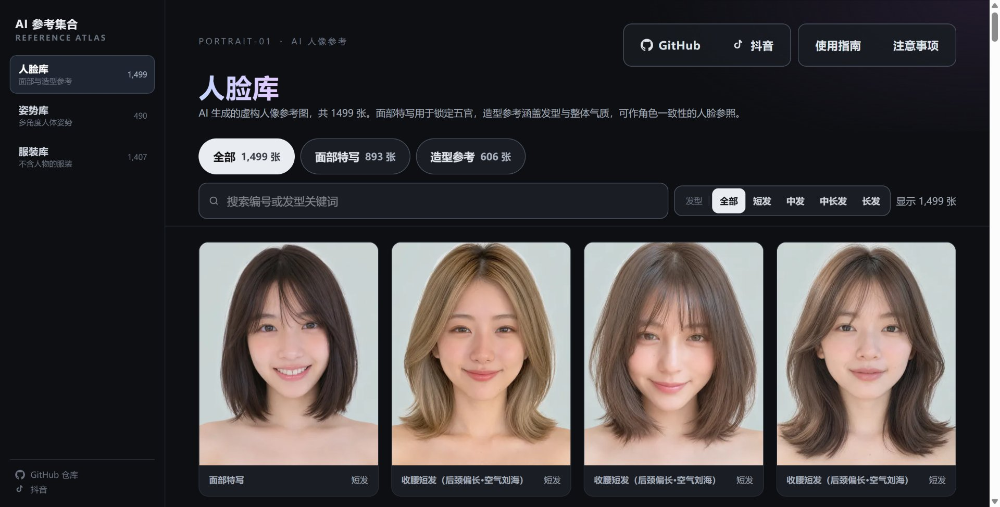
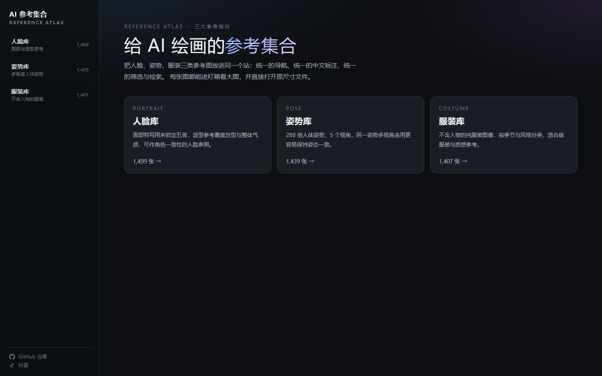
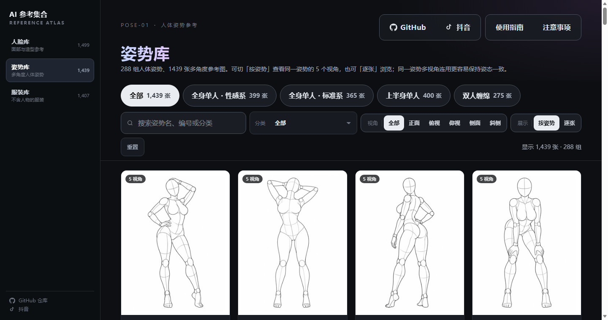

<div align="center">

# AI 参考集合 · 人脸 / 姿势 / 服装

### **在线访问 → <https://ai-costume-gallery.site/>**

<a href="https://ai-costume-gallery.site/"></a>

**人脸 1,499 · 姿势 490 · 服装 1,407** ｜ 全部中文化，一套导航贯穿三库

</div>

> 把三个人像参考图库整合进一个站：同一套侧边导航、同一套筛选与检索逻辑，缩略图全部本地化。

<details><summary>落地页 / 姿势库预览</summary>





</details>

**仓库：** <https://github.com/GodAI-Master/ai-reference-atlas-zh>

| 板块 | 原始站点 | 原作者 |
| --- | --- | --- |
| 人脸库 | <https://ai-portrait-gallery.pages.dev/> | あぎ（CC0） |
| 姿势库 | <https://ai-pose-gallery.anhao.app/>（中文镜像） | ギア（[@giaaibusi](https://x.com/giaaibusi)） |
| 服装库 | <https://ai-costume-gallery.pages.dev/> | ギア（[@giaaibusi](https://x.com/giaaibusi)） |

---

## 三个板块

| 板块 | 路由 | 条数 | 筛选维度 |
| --- | --- | ---: | --- |
| 人脸库 | `/portrait` | 1,499 | 类型（面部特写 893 / 造型参考 606）× 发型（短发 / 中发 / 中长发 / 长发） |
| 姿势库 | `/pose` | 490 | 体系（2）× 动作分类（10）× 视角（5），98 组姿势 |
| 服装库 | `/costume` | 1,407 | 分类（春 / 夏 / 秋 / 冬 / 内衣 / 派对 / 泳装 / 性感） |

首页 `/` 是三个板块的入口页，左侧固定导航贯穿全站，移动端收为顶部横向导航。

## 这是什么

三个源站各自是独立站点：日文或中文、单页静态 HTML、无构建流程、筛选与交互各不相同。本仓库把它们做成一个站：

1. **统一数据模型** —— 三套完全不同的字段（`カテゴリ`+英文关键词 / 体系+分类+视角 / section+hair+style）归一到同一份 schema：`{ id, f[], n, d, t, tu, u, w, h }` + facet 声明，前端只认一种结构。
2. **完整中文化** —— 服装库 8 个分类与 86 个英文关键词、人脸库 2 个类型 / 4 种发型 / 50 个日文发型名，逐条译为中文；姿势库源站本身已是中文版。
3. **可用的前端** —— Next.js 16 + React 19 重写，保留三个源站的核心交互并统一视觉：分类筛选、关键词搜索、分批加载、灯箱、原图下载。

## 页面功能

**全站通用**

- 左侧板块导航，标注各库总量，当前板块高亮
- 工具栏吸顶，筛选后列表回到顶部
- 关键词搜索同时匹配 ID、名称、分类与维度值（中英文均可）
- 每批 120 条，`加载更多` 或滚动到底自动追加
- 灯箱：`← / →` 上一张 / 下一张，`Esc` 关闭，关闭后焦点回到原卡片；手机可左右滑动
- 灯箱内 `打开原图` 直达源站原尺寸文件，本地缩略图先打底，大图解码后淡入
- 使用指南 / 注意事项浮层，文案按库分别撰写

**各库特有**

| 库 | 特有交互 |
| --- | --- |
| 人脸库 | 类型标签 + 发型分段按钮（≤6 个取值用分段控件，避开原生下拉的样式问题） |
| 姿势库 | 「按姿势 / 逐张」双模式；**同一姿势 4–5 个视角**，灯箱内 `← / →` 切视角、`↑ / ↓` 切姿势，右侧列出体系 / 编号 / 分类 / 当前视角 / 图片规格 |
| 服装库 | 8 个分类标签；卡片描述展示中文关键词（象牙白 · 荷叶边 · 针织 …） |

## 目录结构

```
.
├── src/
│   ├── app/
│   │   ├── layout.tsx                  # 外壳：侧边导航 + 元数据
│   │   ├── page.tsx                    # 落地页（三板块入口）
│   │   ├── costume/page.tsx            # 服装库
│   │   ├── pose/page.tsx               # 姿势库
│   │   ├── portrait/page.tsx           # 人脸库
│   │   ├── shell.css                   # 外壳、工具栏、分段控件
│   │   ├── costume-gallery.css         # 源站样式（逐条搬运）+ 补充
│   │   └── api/costume-png/[id]/route.ts   # 服装原图下载代理
│   ├── components/
│   │   ├── site/                       # 侧边导航、浮层文案（三套）
│   │   ├── gallery/                    # 通用画廊 + 姿势专用画廊
│   │   └── sites/costume-gallery/      # 服装库组件、中文词表、检索
│   └── data/
│       ├── costumes.json               # 服装 1407 条（源站原字段）
│       └── galleries/
│           ├── pose.json               # 姿势 490 条（含分组与视角）
│           └── portrait.json           # 人脸 1499 条（名称已汉化）
├── public/sites/
│   ├── costume-gallery/thumbs/         # 1407 张
│   ├── pose-gallery/thumbs/            # 490 张
│   └── portrait-gallery/thumbs/        # 1499 张
├── docs/
│   ├── galleries/                      # 数据集构建脚本 + CDP 验证脚本
│   ├── research/                       # 源站调研、下载脚本、快照
│   └── design-references/atlas/        # 三库截图
├── LICENSE
└── README.md
```

## 数据与构建

数据集是**生成产物**，脚本在 `docs/research/galleries/`：

```bash
# 从源站数据重建（需先把 images.js / pose-zh.json 下载到本地）
node docs/research/galleries/build-portrait.mjs <images.js> .
node docs/research/galleries/build-pose.mjs     <pose-zh.json> .
```

统一 schema：

| 字段 | 说明 |
| --- | --- |
| `id` | 唯一标识 |
| `f[]` | 各维度取值，顺序与 `facets` 对齐 |
| `n` / `d` | 卡片主标题 / 副标题 |
| `t` / `tu` | 本地缩略图路径 / 远端缩略图（本地缺失时回退） |
| `u` | 源站原尺寸图 URL |
| `w` `h` | 缩略图原始尺寸，用于稳定布局 |

## 内容审核

姿势库上游是成人向参考集。为让站点可以公开访问，`build-pose.mjs` 内置了过滤规则（`DROP_SYSTEMS` / `DROP_CATEGORIES` 常量，带注释，改一行即可调整）：

| 移除对象 | 条数 | 原因 |
| --- | ---: | --- |
| 体系「双人缠绵」 | 275 | 双人性行为姿势 |
| 体系「全身单人・性感系」 | 399 | 情色引导姿势 |
| 分类「性感・大胆系」 | 150 | 双手捧胸等 |
| 分类「挤胸・强调事业线系」 | 125 | 刻意强调胸部 |
| **合计** | **949** | 1439 → 490 |

移除条目的缩略图已从仓库删除，不是仅从列表隐藏。保留的是站姿、坐姿、跪立、蹲姿、趴卧等中性人体参考。

## 本地开发

```bash
npm install
npm run dev      # http://localhost:3000
npm run check    # lint + typecheck + build
```

## 部署到 Vercel

```bash
npx vercel deploy --prod
```

**自定义域名的坑（实测记录）**：接入前先确认根域是否在公共后缀列表（PSL）里。

- 在 PSL 内的免费二级域名（如 `de5.net`），Vercel 把 `xxx.de5.net` 视为独立域名，绑定直接 `verified: true`，只需一条 CNAME。
- 不在 PSL 的域名（如 `bbroot.com`）会被要求在其根域添加 `_vercel.<根域>` 的 TXT 记录；根域不在你手上时这条路走不通。

## 素材说明

| 层级 | 本地 | 说明 |
| --- | --- | --- |
| 缩略图（三库共 3396 张） | ✅ 全部镜像 | 人脸 400×500 webp、姿势 300×400 jpg、服装 270×405 webp |
| 展示图 / 原图 | ❌ 指向源站 | 人像 1122×1402 PNG、姿势 900×1200 PNG、服装 1366×2048 PNG |

大图未落地：三个源站都有限速（实测约 10 KB/s），人脸原图合计 4.5 GB、服装 1.5 GB、姿势约 1.3 GB，不具备可行性。因此灯箱以本地缩略图打底，解码成功后再升级为源站大图；缺失的缩略图会自动回退到源站 URL，镜像不完整也不会开天窗。

## 版权与致谢

- **图片与原始数据的著作权归各自原作者所有**：人脸库 あぎ（CC0）、姿势库与服装库 ギア（@giaaibusi）。来源地址见页首。
- 本仓库仅为个人学习、汉化与前端工程实践存档，**不对图片主张任何权利**，也不构成对原作品的商业使用授权。
- 图片数据本身的再分发、转载、转售由原作者禁止；如需商用请自行联系原作者。
- 姿势库的中文数据来自镜像站 [anhao/ai-pose-gallery-zh](https://github.com/anhao/ai-pose-gallery-zh)，在此致谢。
- 若原作者认为本仓库侵犯其权益，请通过 [Issue](https://github.com/GodAI-Master/ai-reference-atlas-zh/issues) 联系，将立即删除相关内容。
- `LICENSE` 采用 MIT，**该协议只覆盖本仓库的代码**（`src/`、脚本与样式），**不覆盖** `public/sites/`、`src/data/` 中的图片与原始数据。
- 前端脚手架来自 [JCodesMore/ai-website-cloner-template](https://github.com/JCodesMore/ai-website-cloner-template)（MIT），在此基础上完成三站整合与汉化。
